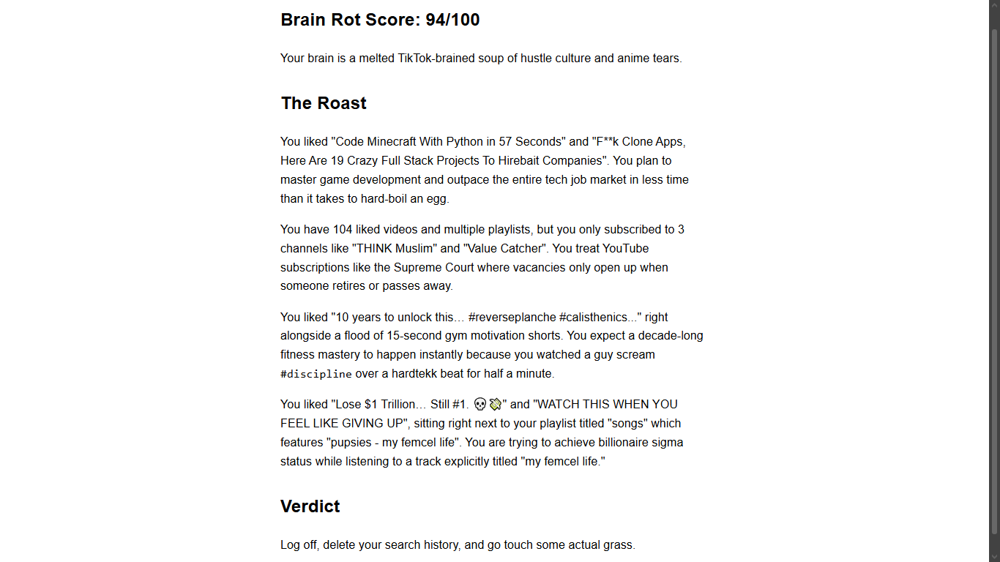

# YouTube Roast

A web app that logs you in with Google, reads your YouTube liked videos, subscriptions and playlists, and asks Gemini to write a funny roast about your taste, with a "Brain Rot Score".

**Live demo:** https://youtube-roast.onrender.com
**Demo video:** C:\Users\Aliyan Bin Zubair\OneDrive\Desktop\YoutTube\Demo_video.mp4

> **Note:** The Google app is in testing mode, so only approved test users can log in. Watch the demo video to see it working.
> The free host sleeps when idle, so the first load can take up to a minute.



## How it works

1. The user clicks **Login with Google**. The app uses OAuth 2.0 (authorization code flow) with the read-only YouTube scope.
2. After login, the server exchanges the code for an access token and keeps it in a signed session cookie.
3. On **Roast me**, the server calls the YouTube Data API to collect liked videos, subscriptions and playlists (with pagination).
4. The data is cleaned and counted in Python (top channels, removed deleted videos), then sent to Gemini in **two steps**: one call finds the funniest angles, a second call writes the roast from them.
5. The result is converted from Markdown to a styled HTML page.

## Tech

- Python, FastAPI, Uvicorn
- Authlib (Google OAuth), httpx (YouTube API calls)
- Google Gemini API (`google-genai`) with retry and model fallback
- Deployed on Render

## Run it locally

1. Create a Google Cloud project, enable **YouTube Data API v3**, and create an **OAuth client**. Add `http://localhost:8000/callback` as an authorized redirect URI, and add your email as a test user.
2. Get a Gemini API key from Google AI Studio.
3. Create a `.env` file:

```
GOOGLE_CLIENT_ID=...
GOOGLE_CLIENT_SECRET=...
GEMINI_API_KEY=...
SESSION_SECRET=a-long-random-string
```

4. Install and run:

```
pip install -r requirements.txt
uvicorn main:app --port 8000
```

5. Open `http://localhost:8000` (use `localhost`, not `127.0.0.1`, or the login cookie won't match).

For a deployed copy, also set `BASE_URL` to your public address (for example `https://your-app.onrender.com`) and add `<BASE_URL>/callback` in Google Console.

## What I learned

- How OAuth 2.0 works: client ID and secret, the authorization code, and why the code is exchanged server-side.
- How session cookies are signed, and why a signature is not encryption.
- Paginating an API and writing reusable async helpers.
- Prompt design: splitting "find the jokes" from "write the roast" gave better results than one big prompt.
- Handling real API failures: 503 (retry with backoff), 429 (quota, fall back to another model), 404 (retired model).

## Known limitations

- **YouTube's API doesn't expose watch history.** The roast is based on likes, subscriptions and playlists, so it can't know how often you watched anything.
- The access token is stored in a signed (not encrypted) cookie and expires after about an hour; there is no refresh token flow yet.
- No data is saved on the server. The free Gemini quota is shared, so heavy use can run out.

## Ideas for next steps

- Import an optional Google Takeout watch-history file for a more accurate roast.
- Store tokens server-side and add refresh tokens.
- A "gentle mode" option for a softer roast.